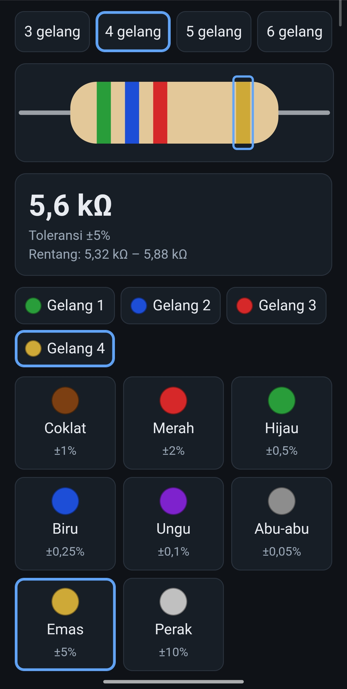
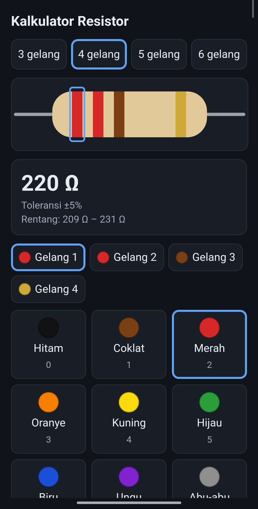

# Kalkulator Kode Warna Resistor

Kalkulator kode warna resistor berbasis web untuk resistor **3, 4, 5, dan 6 gelang**. Pilih warna tiap gelang, nilai hambatan dan toleransi, serta rentangnya tampil seketika.

**[Coba langsung → rivanfathur-rgb.github.io/kalkulator-resistor](https://rivanfathur-rgb.github.io/kalkulator-resistor/)**

## Demo

<p align="center">
  <video src="https://github.com/rivanfathur-rgb/kalkulator-resistor/raw/main/docs/vid.mp4" controls muted width="100%"></video>
</p>

<p align="center">
  
  
  
</p>

## Fitur

- Mode **3, 4, 5, dan 6 gelang** 
- **Gambar resistor interaktif** (SVG): warna gelang berubah sesuai pilihan, dan gelang bisa diketuk langsung untuk dipilih
- Pilihan warna menyesuaikan jenis gelang (digit, pengali, toleransi, atau koefisien suhu), lengkap dengan arti tiap warna
- Hasil otomatis dalam Ω, kΩ, MΩ, atau GΩ, beserta **toleransi** dan **rentang nilai minimum–maksimum**
- Mode 6 gelang menampilkan **koefisien suhu (ppm/°C)**
- Warna digit dan pengali tetap tersimpan saat berpindah antar mode
- Responsif untuk HP, mengikuti mode terang/gelap perangkat
- Ringan: satu file HTML, tanpa library, tanpa request tambahan

## Cara pakai

1. Pilih jumlah gelang di bagian atas (3, 4, 5, atau 6).
2. Pilih gelang yang ingin diatur (tombol **Gelang 1, 2, ...** atau ketuk gelang di gambar).
3. Pilih warnanya dari daftar di bawah. Gambar dan hasil langsung diperbarui.

**Contoh:** Coklat – Hitam – Merah – Emas (4 gelang) = 10 × 100 = **1 kΩ ±5%**

## Susunan gelang

| Mode | Susunan gelang |
|------|----------------|
| 3 gelang | digit 1, digit 2, pengali (toleransi ±20%) |
| 4 gelang | digit 1, digit 2, pengali, toleransi |
| 5 gelang | digit 1, digit 2, digit 3, pengali, toleransi |
| 6 gelang | digit 1, digit 2, digit 3, pengali, toleransi, koefisien suhu |

## Tabel warna

| Warna | Digit | Pengali | Toleransi | Koef. suhu |
|-------|:-----:|---------|-----------|------------|
| Hitam | 0 | ×1 | – | 250 ppm/°C |
| Coklat | 1 | ×10 | ±1% | 100 ppm/°C |
| Merah | 2 | ×100 | ±2% | 50 ppm/°C |
| Oranye | 3 | ×1 k | – | 15 ppm/°C |
| Kuning | 4 | ×10 k | – | 25 ppm/°C |
| Hijau | 5 | ×100 k | ±0,5% | 20 ppm/°C |
| Biru | 6 | ×1 M | ±0,25% | 10 ppm/°C |
| Ungu | 7 | ×10 M | ±0,1% | 5 ppm/°C |
| Abu-abu | 8 | ×100 M | ±0,05% | 1 ppm/°C |
| Putih | 9 | ×1 G | – | – |
| Emas | – | ×0,1 | ±5% | – |
| Perak | – | ×0,01 | ±10% | – |

## Teknologi

- HTML, CSS, dan JavaScript murni (vanilla), tanpa framework dan tanpa dependensi
- SVG inline untuk gambar resistor
- Di-host dengan GitHub Pages

## Menjalankan di lokal

Tidak perlu instalasi atau build. Unduh atau clone repo ini, lalu buka `index.html` di browser.

```bash
git clone https://github.com/rivanfathur-rgb/kalkulator-resistor.git
cd kalkulator-resistor
# buka index.html di browser
```

## Deploy ke GitHub Pages

1. Buka **Settings → Pages**.
2. Pada *Source*, pilih **Deploy from a branch**, lalu branch `main` dan folder `/ (root)`.
3. Klik **Save**. Situs akan aktif di `https://<username>.github.io/kalkulator-resistor/`.

## Ide pengembangan

- Mode kebalikan: masukkan nilai hambatan, tampilkan kombinasi warnanya
- Pembulatan ke nilai standar deret E12/E24
- PWA agar bisa dipakai offline dan dipasang di layar utama HP

## Lisensi

Dirilis di bawah [Lisensi MIT](LICENSE).

Dibuat oleh [rivanfathur-rgb](https://github.com/rivanfathur-rgb).
